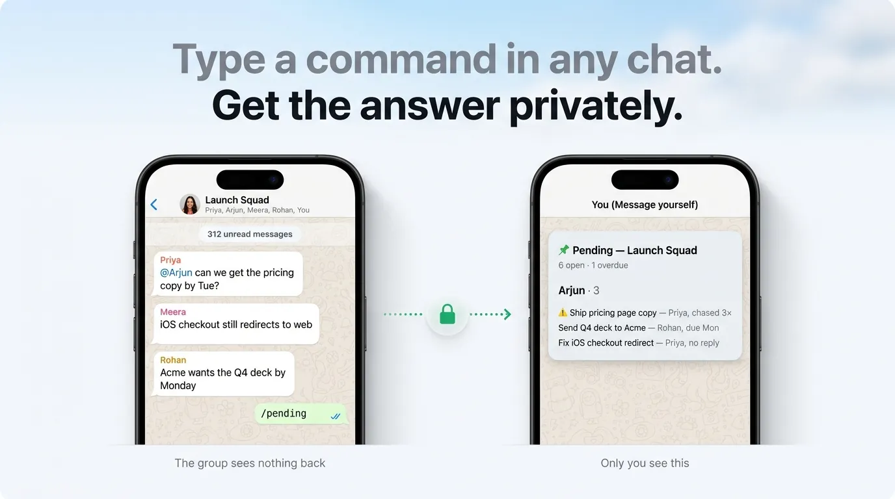
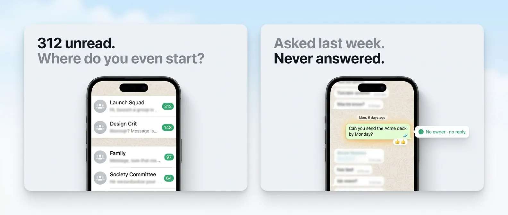
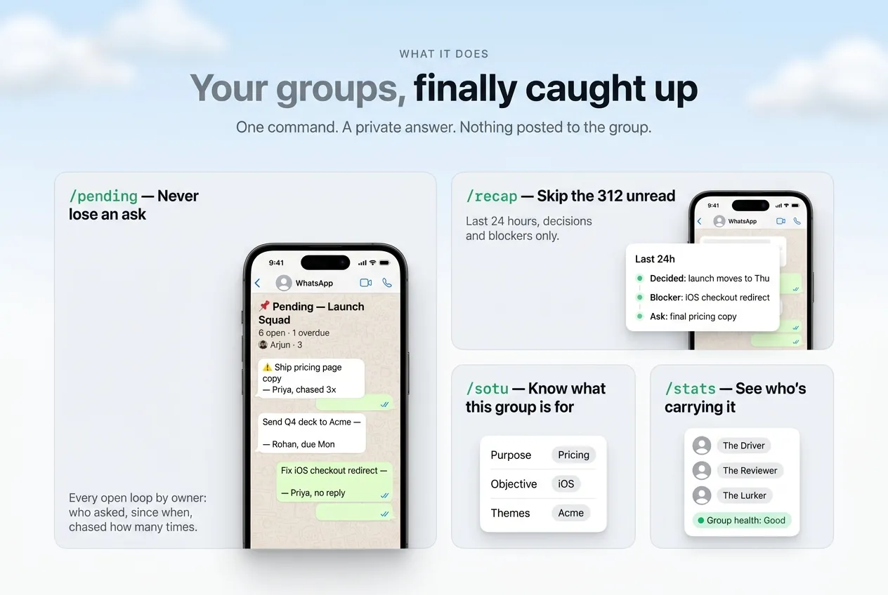
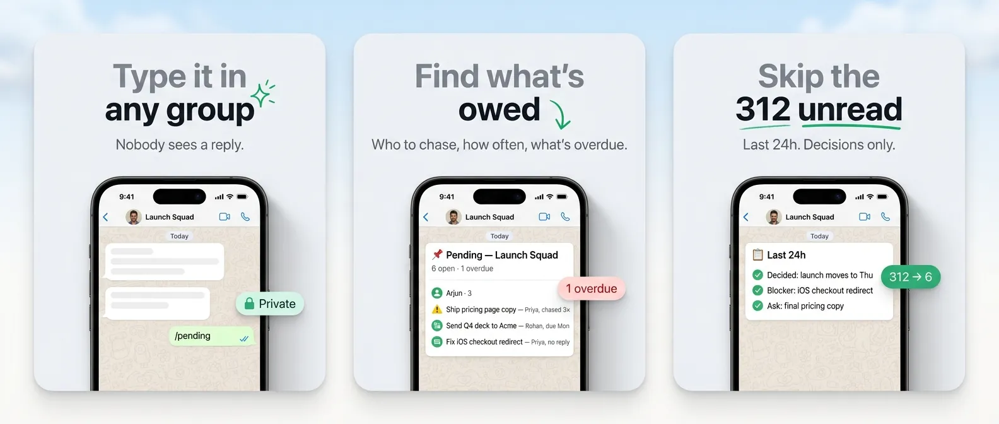
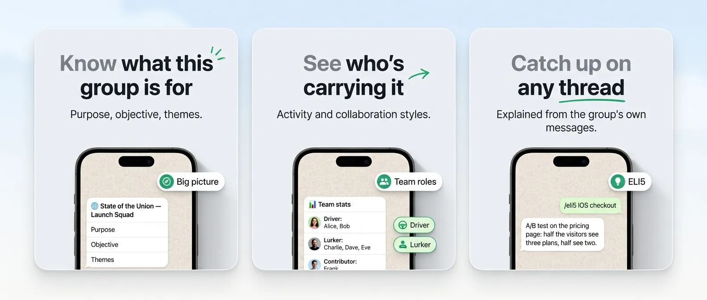
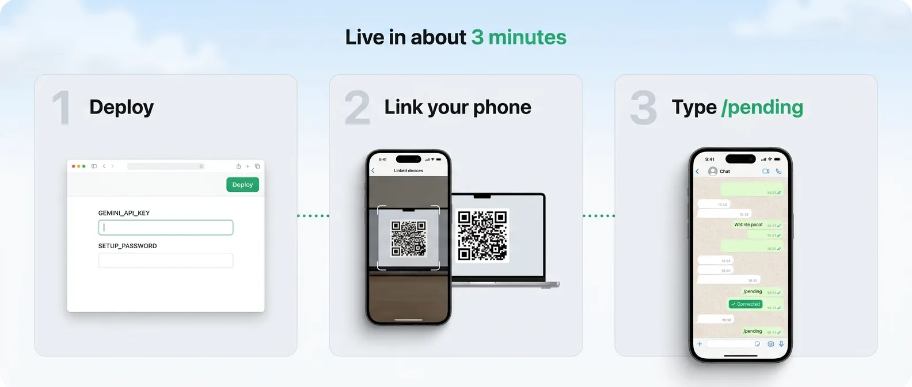
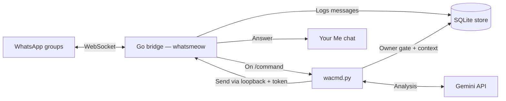

<div align="center">

<p align="center">
<picture>
  <source media="(prefers-color-scheme: dark)" srcset="assets/hero-v2-dark.webp">
  
</picture>
</p>

<h3><strong>312 unread messages. 3 things you actually owe. One command to find them.</strong></h3>

<a href="https://railway.com/deploy/wa-slash-commands"></a>

<br>


<a href="https://github.com/sameer-hoda/wa-slash-commands/actions/workflows/ci.yml"></a>

</div>

---

## The problem

**Groups move faster than you can read.** You open *Launch Squad* to **312 unread**.
Somewhere in there is the one thing someone needs from you by Tuesday — but WhatsApp's
message search can only find words you already remember. It can't tell you what's still
owed, by whom, or since when.

<p align="center">
<picture>
  <source media="(prefers-color-scheme: dark)" srcset="assets/problem-v2-dark.webp">
  
</picture>
</p>

**Asks die in the scroll.** "Can you send the deck by Monday?" got two 👍 and was never
seen again — last week's asks buried under hundreds of messages. Nobody owns it, nobody
chases it, and it surfaces only when it's already late.

wa-slash-commands is one command that reads the room for you.

## What it does

<p align="center">
<picture>
  <source media="(prefers-color-scheme: dark)" srcset="assets/bento-v2-dark.webp">
  
</picture>
</p>

## Built to be trusted

- **Invisible** — answers land in your *Me chat*; the group sees only what you typed.
- **Honest AI** — dates and chase counts are computed in code, never invented by the model.
- **Fails loud** — if Gemini is down, you get an explicit error, never a fake "all clear".
- **Self-hosted** — history in your own SQLite; each command sends only the message text
  it needs to the Gemini API. No external database, no telemetry.

## Show me

<p align="center">
<picture>
  <source media="(prefers-color-scheme: dark)" srcset="assets/showcase-1-dark.webp">
  
</picture>
</p>

<p align="center">
<picture>
  <source media="(prefers-color-scheme: dark)" srcset="assets/showcase-2-dark.webp">
  
</picture>
</p>

*Illustrative screenshots built with fictional data — no real chats are shown.*

## Start on Railway (recommended, ~3 minutes)

<p align="center">
<picture>
  <source media="(prefers-color-scheme: dark)" srcset="assets/setup-v2-dark.webp">
  
</picture>
</p>

1. Hit **Deploy on Railway** (button above) — the template asks for exactly two things:
   your `GEMINI_API_KEY` and a `SETUP_PASSWORD`. Nothing is baked in.
2. Open the deployed URL, log in with your setup password and
   **link your phone**: WhatsApp → <kbd>Settings → Linked devices → Link a device</kbd> →
   scan the QR.
3. When the page says `Connected as +91… · Me chat: …` (and a welcome lands in your
   Me chat), type `/pending` in any group. Done.

Prefer a terminal? One command does all of the above:

```bash
bash <(curl -fsSL https://raw.githubusercontent.com/sameer-hoda/wa-slash-commands/master/deploy-railway.sh)
```

The `/data` volume (it holds your pairing and message history) is required and the service
stays at **one replica** — both are handled by the template and the deploy script.
Full details and troubleshooting: [docs/RAILWAY.md](docs/RAILWAY.md). Re-running the deploy
updates in place and keeps your pairing.

<details>
<summary>Running locally instead (macOS / Linux)</summary>

```bash
# all-in-one: dependency check, clone, setup wizard
bash <(curl -fsSL https://raw.githubusercontent.com/sameer-hoda/wa-slash-commands/master/install.sh)
```

or by hand:

```bash
git clone https://github.com/sameer-hoda/wa-slash-commands.git
cd wa-slash-commands
pip install -r requirements.txt        # Python 3.10+
python3 setup.py                       # writes your key into .env, compiles the Go bridge
./start.sh
```

Then open `http://localhost:8081/`, log in with the setup password (`SETUP_PASSWORD` in
`.env`, or generated and printed in the logs), scan the QR from WhatsApp's Linked devices
and wait for `Connected as +91…`. Prerequisites: Python 3.10+, Go 1.26+
(the Go toolchain auto-seeds itself if missing).

</details>

## Commands

Type these from your phone in **any** chat. The answer always arrives in your Me chat —
the chat you typed in stays untouched.

| Command | What you get | Looks at |
| :--- | :--- | :--- |
| `/pending` | **Open loops by owner** — what everyone asked you for and you asked of them, since when, chased how many times, what's overdue. | 7 days |
| `/sotu` | **State of the Union** — the group's purpose, big-picture objective, key themes, and the one thing asked for most recently. | 30 days |
| `/stats` | **Personas** — participant activity with collaboration styles (*The Driver*, *The Reviewer*, *The Lurker*…) and a group-health read. | 14 days |
| `/recap` | **24h timeline** — decisions, blockers and asks from the last day, noise filtered out. | 24 hours |
| `/eli5 ⟨topic⟩` | **Explain like I'm 5 — from this group** — a plain-English explainer grounded in what the group actually discussed. | 30 days |
| `/help` | The command briefing itself, in your Me chat. | — |

## Privacy & safety

- **Me chat only.** The bridge resolves your self-chat at launch (`mechat.py`) and
  re-verifies it on every send; unresolved means *nothing is sent anywhere*.
- **The source chat is never written to** — no messages posted, nothing deleted.
- **Owner-gated.** Commands only run for the paired phone's identity (PN or LID form).
  Everyone else's `/anything` is silently ignored.
- **Local history.** Messages live in SQLite on your machine/volume. No external database,
  no telemetry.
- **Minimal AI exposure.** Only the message text needed to answer your command is sent to
  the Gemini API — media, contacts and metadata stay local.
- **Locked-down send path.** The send API is loopback-only (`127.0.0.1`) and token-gated;
  the setup page sits behind your `SETUP_PASSWORD`.

## How it works



1. **Go bridge** — keeps the WhatsApp connection alive, persists every message to SQLite,
   serves the setup page (QR, pairing status, Gemini-key check) and a `/health` endpoint.
2. **Python engine** — on a `/command`, the bridge execs `wacmd.py`: it verifies the sender,
   pulls context from SQLite, calls Gemini with strict JSON schemas (`engine.py`,
   `ledger.py`), and renders the answer with WhatsApp-native formatting.
3. **Me-chat resolver** — `mechat.py` decides *where* answers are allowed to land:
   env override → pairing store (PN + LID) → freshest self-chat in the database. If it
   cannot resolve your Me chat, the system refuses to send rather than guess.

## FAQ

<details>
<summary>Is this safe to use with my WhatsApp account?</summary>

The bridge speaks WhatsApp's own protocol through the open-source
[whatsmeow](https://github.com/tulir/whatsmeow) library — exactly like WhatsApp Web or
Desktop does. There is no official bot API for personal accounts, so this is an
unofficial integration: it appears as a linked device in
<kbd>Settings → Linked devices</kbd>, can be unlinked anytime, and — like any
third-party client — carries a small, real risk of account action. Use a secondary
number to try it out first if that worries you.

</details>

<details>
<summary>What exactly gets sent to Gemini?</summary>

The text of messages from the target chat's look-back window (e.g. last 7 days for
`/pending`), plus your resolved display names for those senders. No media, no contacts,
no group metadata, and nothing from chats you didn't run a command in.

</details>

<details>
<summary>What does it cost?</summary>

The software is free (MIT). You need a
[Gemini API key](https://aistudio.google.com/apikey) from a **billing-enabled** project:
on the free tier Google may use your traffic to improve its models — which you probably
don't want for group messages — while paid key usage is cents per command. On Railway,
plan on a hobby instance (≈ $5/mo) for the always-on container.

</details>

<details>
<summary>Which model does it use, and can I change it?</summary>

The engine ships with `gemini-2.5-flash-lite` (`GEMINI_MODEL` in `engine.py`) — measured
equal open-loop recall to the pricier models at a fraction of the latency. To benchmark
other models against *your real history*:

```bash
python3 scripts/evaluate_models.py
```

</details>

<details>
<summary>What if the AI is down or my key is broken?</summary>

You get an explicit error in your Me chat — never a politely fake "all clear". `python3
scripts/test_api.py` verifies your key supports text and strict-JSON generation; `wacmd.py`
logs payload sizes and the earliest message pulled so you can debug context limits.

</details>

<details>
<summary>Does it work in DMs, big groups, multiple chats?</summary>

Yes — the owner can run commands in any chat the account belongs to, one or many.
Group size is bounded by the engine's payload truncation (~100k characters of history,
most-recent-first); very active groups may need `/recap` instead of `/sotu`.

</details>

<details>
<summary>Do group members or admins see any bot activity?</summary>

No. The group receives exactly the message you typed (`/pending`) and nothing else —
no replies, no edits, no deletions. Admins see a normal text message sent by you.

</details>

## Tools & diagnostics

```bash
python3 -m pytest tests/ -q       # offline test suite — no network, no keys needed
python3 scripts/test_api.py       # is my Gemini key healthy? (text + JSON schema)
```

Model benchmarking and the `/pending` approach lab (`sandbox/`) —
see [CONTRIBUTING.md](CONTRIBUTING.md).

---

MIT © [Sameer Hoda](https://github.com/sameer-hoda) ·
[CHANGELOG](CHANGELOG.md) ·
[Security policy](SECURITY.md) ·
[Railway deploy guide](docs/RAILWAY.md) ·
[Setup guide](SETUP.md)

*Not affiliated with WhatsApp or Meta.*
