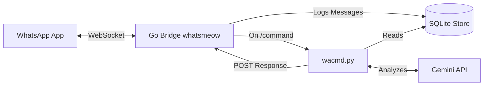

<div align="center">
  <h1>💬 wa-slash-commands</h1>
  <p><strong>An AI-powered Chief of Staff inside your WhatsApp group chats.</strong></p>
  
  <p>
    
    
    
  </p>

  <p>
    <a href="https://railway.com/deploy/wa-slash-commands">
      
    </a>
  </p>
</div>

`wa-slash-commands` is a standalone, intelligent WhatsApp CLI integration that turns any WhatsApp chat into a productive workspace. It leverages a native Go bridge (`whatsmeow`) and the Google Gemini API to analyze conversations, extract rich insights, and answer `/slash` commands — **every answer delivered privately to your own Me chat** (self-chat), never into the group you typed it in.

## ✨ Features

- 🔒 **Owner-Protected**: Strict security checks ensure commands are *only* executed when sent by your personal phone number. Other group members typing `/commands` are silently ignored.
- 🙋 **Me-chat only**: Every answer lands in your own "Message yourself" chat. The source chat is never written to — no posts, no deletions, no traces that you use a bot.
- 🧠 **AI-Powered Synthesis**: Powered by Gemini 1.5 with Strict JSON Schema Enforcement to guarantee structured, non-hallucinated responses.
- 📦 **Self-Contained**: Comes with an embedded, auto-compiling Go bridge. No complex external dependencies or webhooks required.
- ⚡ **Zero-Config Onboarding**: A web setup page shows the QR code, a Gemini-key validity tick, and the resolved Me chat. Nothing to configure in a terminal.

## 🚀 Available Commands

Type these from your phone in **any** chat. The answer always arrives in your **Me chat**
(Message yourself) — the chat you typed in stays untouched:

| Command | Description | Time Window |
| :--- | :--- | :--- |
| `/sotu` | **State of the Union:** Identifies the group's purpose, big picture objectives, key themes, and decisions. | 30 Days |
| `/pending` | **Critical Open Loops:** Scans history to track ongoing initiatives and outputs actionable "Next Steps" with DRIs. | 30 Days |
| `/stats` | **Team Personas:** Analyzes participant activity and labels them with collaboration styles (e.g., *The Driver*, *The Lurker*). | 14 Days |
| `/recap` | **24h Timeline:** Extracts only critical signals and decisions from the past 24 hours, filtering out noise. | 24 Hours |
| `/eli5 <topic>` | **Explain Like I'm 5:** Context-aware search engine that explains a topic based strictly on what was discussed. | 30 Days |

---

## ⚡️ One-Line Installation (Recommended)

The fastest way to get started on macOS or Linux. This command will check for dependencies (Python, Go, Git), clone the repo, and start the setup wizard automatically:

```bash
curl -sL https://raw.githubusercontent.com/sameer-hoda/wa-slash-commands/master/install.sh | bash
```

---

## 🛠 Installation & Quick Start

**Prerequisites**: Python 3.10+ and Go 1.21+.

1. **Clone the repository:**
   ```bash
   git clone https://github.com/sameer-hoda/wa-slash-commands.git
   cd wa-slash-commands
   ```

2. **Install Python dependencies:**
   ```bash
   pip install -r requirements.txt
   ```

3. **Run the interactive setup wizard:**
   ```bash
   python3 setup.py
   ```
   *The wizard will prompt you for your Gemini API key and compile the native WhatsApp bridge. You can also just set `GEMINI_API_KEY` in `.env`.*

4. **Start the Bridge:**
   ```bash
   ./start.sh
   ```

5. **Open the setup page and link your phone:**
   ```
   http://localhost:8081/
   ```
   Log in with the setup password (from `SETUP_PASSWORD`, or printed in the logs), scan
   the QR via **Linked devices → Link a device**, and within seconds the page shows
   `Connected as +91… · Me chat: …`. A one-time welcome lands in that Me chat — that's
   your confirmation that answers are routed correctly.

---

## ☁️ Deploy on Railway

**You need:** a free [Railway account](https://railway.com) and a
[Gemini API key](https://aistudio.google.com/apikey) (billing-enabled project).

### Fastest: one command (macOS / Linux / WSL)

```bash
bash <(curl -fsSL https://raw.githubusercontent.com/sameer-hoda/wa-slash-commands/master/deploy-railway.sh)
```

It asks for your Gemini key and a setup password, then does everything else:
installs the Railway CLI, signs you in, creates the project, attaches the `/data`
volume, sets variables, builds, gives you a URL and opens it. Then:

1. Log in to the page with your setup password.
2. WhatsApp → **Settings → Linked devices → Link a device** → scan the QR.
3. Wait for `Connected as +91…` — a welcome lands in your Me chat. Type `/pending` in any group.

Re-run the same command anytime to update; your WhatsApp pairing is kept.

### Other ways

[](https://railway.com/deploy/wa-slash-commands)

*The button opens the published Railway template (`wa-slash-commands`): the
`/data` volume is preconfigured and you'll be asked for your own
`GEMINI_API_KEY`, `SETUP_PASSWORD` and `TZ` — nothing is baked in. Terminal
users can prefer the one-command deploy above or the step-by-step in
[docs/RAILWAY.md](docs/RAILWAY.md).*

Whichever you use, the `/data` volume is **required** (it holds your pairing and
history) and the service must stay at **one replica**.

---

## 📊 AI Model Benchmarking

Not sure which Gemini model works best for your group chats? We have included a professional-grade evaluation harness that pits different models against each other using your actual chat history.

The harness finds your most active group, runs simulated `/sotu` commands across 7+ models (Flash, Pro, Lite, Gemma), and uses a high-tier AI "Judge" to score each model on accuracy and context retention.

```bash
python3 evaluate_models.py
```

---

## 🧪 Troubleshooting & API Tester

If commands like `/eli5` work but `/sotu` or `/recap` return fallback messages (e.g., "Analysis unavailable"), it usually means the chat history payload exceeded Gemini API limits or the schema was rejected.

We have included a diagnostic tool to verify your API key supports both standard text generation and strict JSON schema generation:

```bash
python3 test_api.py
```

Additionally, `wacmd.py` will print detailed logs to your terminal (payload size, earliest message pulled) whenever a command is invoked to help you debug context limits.

---

## 🏗 Architecture

The system is split into two seamless components:

1. **The Go Bridge (`./bridge`)**: Built on the highly stable `whatsmeow` library. It maintains the WebSocket connection to WhatsApp, intercepts incoming messages, and syncs chat history into a local SQLite database (`store/whatsapp.db` & `store/messages.db`).
2. **The Python Engine (`wacmd.py`)**: When the bridge detects a message starting with `/`, it shells out to `wacmd.py`. The Python script verifies the sender's identity (PN or LID form), pulls necessary context from SQLite, executes a strictly typed Gemini API call, and delivers the answer via the bridge's loopback, token-gated send API — **to the resolved Me chat only**. `mechat.py` resolves which chat that is at launch and after every reconnect; unresolved means no send anywhere.



## 🛡 Privacy & Security

- **Me-chat only**: Answers never post into groups and nothing is ever deleted. The chat where you typed a command receives zero writes.
- **Local Storage**: All message history is stored locally in SQLite (`store/`). Nothing is sent to a cloud database.
- **Selective Processing**: Only messages required to fulfill a specific slash command are sent to the Gemini API.
- **Locked down**: the send API is loopback-only and token-gated; the web setup page sits behind a generated password.

## 🧪 Tests

```bash
python3 -m pytest tests/ -q   # offline: no network, no keys needed
```

## 📝 License

Distributed under the MIT License. See `LICENSE` for more information.
